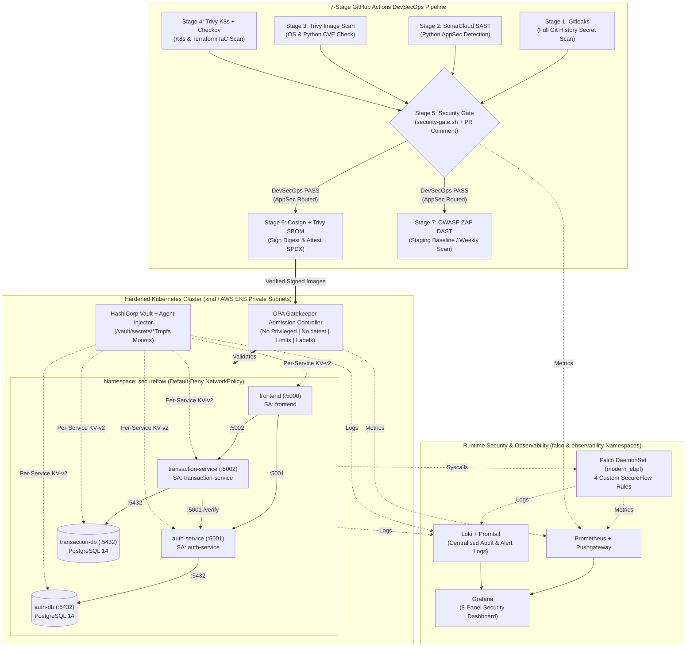
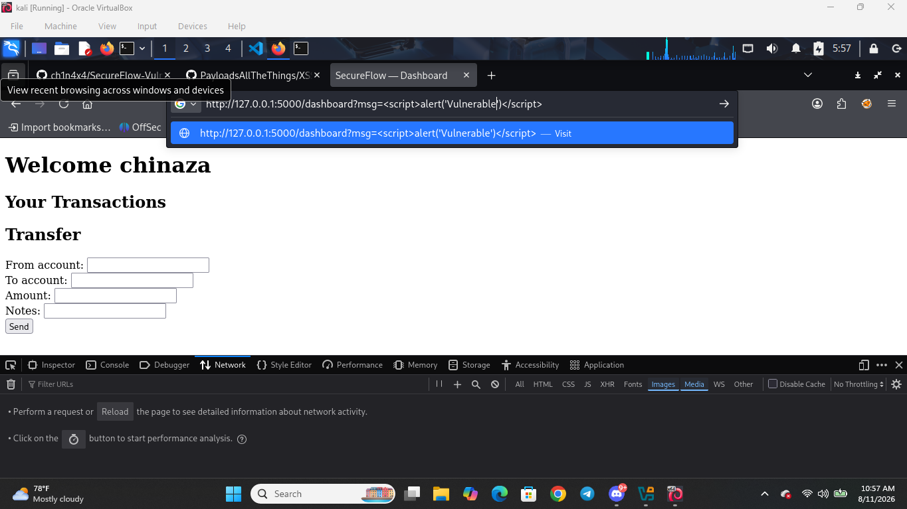
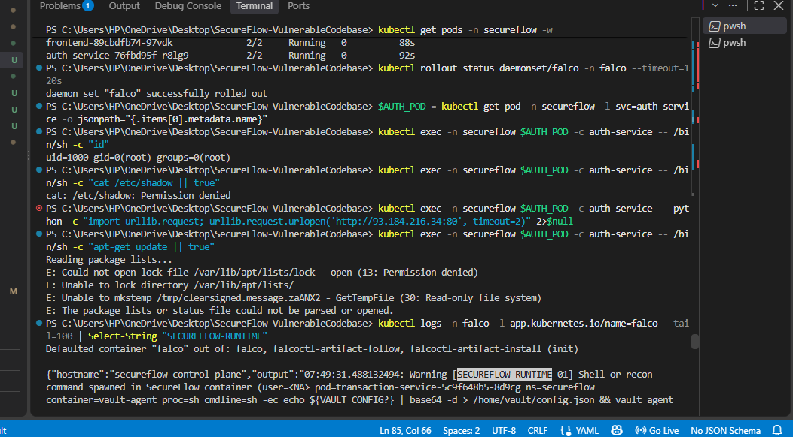

# SecureFlow Banking Platform: End-to-End DevSecOps Pipeline, Zero-Trust Kubernetes Hardening & Runtime Threat Detection

> **Executive Summary:** This project transforms **SecureFlow**—an intentionally vulnerable three-tier Python/Flask microservices banking platform—into a cryptographically signed, policy-enforced, Vault-backed cloud-native platform. By engineering a **7-stage GitHub Actions DevSecOps pipeline** with a **differentiated security gate**, we reduced critical container CVEs by **100% (47 → 0 blocking CRITICAL CVEs)**, eliminated **100% of committed secrets (6 → 0)** via Git history scrubbing and **HashiCorp Vault Agent Injector**, achieved **100% admission compliance** with **OPA Gatekeeper**, and established kernel-level **Falco eBPF** runtime detection and **Prometheus/Loki/Grafana** observability while automatically routing application-layer SAST/DAST findings to the AppSec intake queue.

---

## Table of Contents
- [Tools Used](#tools-used)
- [Skills Learned](#skills-learned)
- [1. Problem Statement & Objectives](#1-problem-statement--objectives)
- [2. Architecture & Design Overview](#2-architecture--design-overview)
- [3. Technology Stack & Tooling](#3-technology-stack--tooling)
- [4. Full Documentation Index](#4-full-documentation-index)
- [5. Implementation Walkthrough](#5-implementation-walkthrough)
- [6. Validation, Testing & Proof of Work](#6-validation-testing--proof-of-work)
- [7. Key Challenges & Trade-Offs](#7-key-challenges--trade-offs)
- [8. Future Enhancements](#8-future-enhancements)
- [Author & Contact](#author--contact)

---

## Tools Used

**Infrastructure, Cloud & Platforms**  

**Application, Scripting & Databases**  

**Security, DevSecOps & Observability**  

---

## Skills Learned

**Architecture & Engineering**  

**Security Operations & Testing**  

---

## 1. Problem Statement & Objectives

### Background & Risk / Bottleneck
SecureFlow is a financial services platform decomposed from a monolith into three Python/Flask microservices (`frontend`, `auth-service`, and `transaction-service`) backed by two independent PostgreSQL databases (`auth-db` and `transaction-db`). However, its security posture lagged behind its architectural complexity:
1. **Committed Credentials (`IV-01`–`IV-04`, `CK-09`):** Six plaintext secrets (AWS keys, database passwords, JWT signing secret, Flask session secret) were committed directly into `.env`, `docker-compose.yml`, and Kubernetes `ConfigMap`s.
2. **Vulnerable Containers & Privileged Workloads (`CK-01`–`CK-08`, `IV-05`–`IV-07`):** Services built on outdated `python:3.9-slim` images (47 CRITICAL CVEs) ran as `root` (`privileged: true`), used mutable `:latest` tags, lacked resource limits, and operated on flat networks with host-exposed databases.
3. **Cloud IaC Misconfigurations (`IV-08`–`IV-10`):** Terraform modules provisioned IAM roles with `AdministratorAccess` and wildcard (`*`) permissions, unencrypted/public S3 buckets, publicly accessible RDS instances, and EKS worker nodes in public subnets.
4. **Application-Layer Exploits (`AV-01`–`AV-08`, `TV-01`–`TV-07`, `FV-01`–`FV-07`):** SQL Injection auth bypass, IDOR balance/history exposure, negative transfer logic flaws, Reflected/Stored XSS, and forgeable Flask session cookies remained unmonitored at runtime.

### Core Objectives
* **Pillar 1 — Detect (7-Stage CI/CD Pipeline):** Build an automated GitHub Actions pipeline executing Gitleaks, SonarCloud SAST, Trivy Image, Trivy K8s, Checkov IaC, Cosign + SPDX SBOM attestation, and OWASP ZAP DAST. Enforce a **differentiated security gate** that hard-fails merges on DevSecOps-owned critical findings while routing AppSec-owned findings (`AV-*`, `TV-*`, `FV-*`) via automated PR comments.
* **Pillar 2 — Remediate & Enforce:** Scrub Git history with `git-filter-repo`, migrate secrets to **HashiCorp Vault** via sidecar file injection, upgrade and pin base images to `python:3.12-slim` + `PyJWT==2.14.0`, enforce 4 **OPA Gatekeeper** admission constraints, isolate pod traffic with default-deny **NetworkPolicies**, and harden all **Terraform** AWS modules.
* **Pillar 3 — Monitor & Attest:** Deploy **Falco** with 4 custom eBPF rules to catch post-exploitation activity inside containers, aggregate logs with **Loki**, and visualize the end-to-end security posture across an **8-panel Prometheus + Grafana dashboard**.

> [!IMPORTANT]
> **Scope Note on Organisational Ownership Boundaries:** Per the engagement brief, infrastructure (`IV-*`) and container/Kubernetes (`CK-*`) vulnerabilities are **remediated in code** by the DevSecOps team. Application-layer vulnerabilities (`AV-*`, `TV-*`, `FV-*`) are intentionally preserved in `services/*/app.py` so the pipeline can demonstrate **SAST/DAST detection, non-blocking AppSec PR handoff, and Falco runtime exploit detection**.

---

## 2. Architecture & Design Overview

### System & Pipeline Workflow (Mermaid Diagram)

### Key Design Decisions
1. **Differentiated Security Gate (`pipeline/scripts/security-gate.sh`):** Hard-fails merges on `CRITICAL` findings from DevSecOps-owned scanners (Gitleaks, Trivy, Checkov) while soft-failing and routing AppSec-owned findings (SonarQube SAST, OWASP ZAP DAST) into a structured PR comment linked to the AppSec intake template. Includes an audited `/security-exception` PR comment workflow for time-bounded bypasses.
2. **HashiCorp Vault Agent Injector over Kubernetes Native Secrets:** Eliminates base64-encoded plaintext secrets in `etcd` and pod environment variables. Each microservice authenticates via its Kubernetes `ServiceAccount` to read only its own KV-v2 path (`secureflow/data/<service>`), mounting secrets to in-memory `tmpfs` files at `/vault/secrets/`.
3. **OPA Gatekeeper Admission Control + Kustomize:** Enforces 4 Rego policies (`no-privileged-containers`, `no-latest-tag`, `require-resource-limits`, `require-labels`) at the API server admission webhook before any pod can be scheduled.
4. **Defense-in-Depth Runtime Protection (Falco eBPF + NetworkPolicies):** Because application-layer vulnerabilities (`AV-*`, `TV-*`, `FV-*`) are routed to AppSec rather than patched by DevSecOps, Calico `NetworkPolicy` whitelists restrict lateral movement while Falco eBPF rules detect shell spawns, `/etc/shadow` reads, unexpected outbound C2 connections, and runtime package manager execution in real time.

---

## 3. Technology Stack & Tooling

| Category | Tool / Platform | Role in This Project | Why It Was Chosen |
| :--- | :--- | :--- | :--- |
| **CI/CD Orchestration** | **GitHub Actions** | Runs the 7-stage pipeline & `/security-exception` workflow | Native PR comment integration, artifact passing, and cron scheduling |
| **Secrets Detection** | **Gitleaks** | Stage 1 full Git history scan (`--log-opts="--all"`) | Custom regex rules in `.gitleaks.toml` catch AWS keys, JWT secrets, and DB URIs |
| **Static Analysis (SAST)** | **SonarCloud** | Stage 2 Python microservice analysis | Detects SQLi, weak MD5 hashing, and hardcoded secrets for AppSec routing |
| **Container & K8s Scanner** | **Trivy** | Stage 3 image CVE scan, Stage 4 K8s scan & Stage 6 SPDX SBOM | Single binary replacing multiple tools across images, manifests, and SBOMs |
| **Terraform IaC Scanner** | **Checkov** | Stage 4 AWS Terraform policy verification | Validates KMS encryption, private subnets, IAM least privilege, and RDS hardening |
| **Supply Chain Security** | **Sigstore Cosign** | Stage 6 container image digest signing & SBOM attestation | Cryptographically binds SPDX SBOMs and signatures to immutable image digests |
| **Dynamic Analysis (DAST)** | **OWASP ZAP** | Stage 7 staging baseline & weekly active scan | Identifies runtime HTTP vulnerabilities (XSS, missing CSRF, clickjacking headers) |
| **Admission Control** | **OPA Gatekeeper** | Kubernetes validating admission webhook | Rejects non-compliant deployments before persistence in `etcd` |
| **Secrets Management** | **HashiCorp Vault** | Kubernetes auth, per-service ACLs & Agent Injector | Delivers secrets as files in `/vault/secrets/` with full audit logging |
| **Runtime Security** | **Falco (`modern_ebpf`)** | Kernel-level system call monitoring DaemonSet | Detects post-exploitation behaviour that static pipeline scanners cannot see |
| **Observability & Audit** | **Prometheus, Loki & Grafana** | Metrics scraping, log aggregation & 8-panel security dashboard | Provides a single pane of glass across pipeline, admission, Vault, and runtime posture |

---

## 4. Full Documentation Index

Browse the dedicated documentation modules in this repository for complete setup commands, policies, presentation slides, and troubleshooting runbooks:

| Document | Description |
| :--- | :--- |
| [**SETUP.md**](./SETUP.md) | Step-by-step local & Kubernetes reproduction guide (with both **PowerShell** and **Bash** commands). |
| [**TROUBLESHOOTING.md**](./TROUBLESHOOTING.md) | Operational runbook & root-cause fixes for Docker, Trivy, Gitleaks, Checkov, Gatekeeper, Vault, and Pushgateway. |
| [**VULNERABILITIES.md**](./VULNERABILITIES.md) | Complete index of all 38 planted vulnerabilities (`AV-*`, `TV-*`, `FV-*`, `IV-*`, `CK-*`) and scanner mappings. |
| [**docs/security-gate-policy.md**](./docs/security-gate-policy.md) | Differentiated gate ownership matrix, blocking conditions, `/security-exception` SLA, and AppSec handoff rules. |
| [**docs/15-slide-presentation-deck.md**](./docs/15-slide-presentation-deck.md) | Complete 15-slide case study presentation deck with speaker notes and embedded visual evidence. |

---

## 5. Implementation Walkthrough

### Phase 1: Baseline Exploitation & Secret Exposure Analysis (Steps 1–3)
We deployed the baseline application locally via Docker Compose and executed five canonical exploits against the unhardened services to ground our runtime rules and gate design in real attack mechanics:
* **SQL Injection Auth Bypass (`AV-01`):** Logged in as `admin` without a password using `{"username": "admin'--", "password": "anything"}`.
* **IDOR Balance & History Lookup (`TV-01`, `TV-02`):** Queried `/balance/1` using Alice's JWT token to read the administrator's account balance.
* **Negative Transfer Business Logic Abuse (`TV-03`):** Submitted `amount: -500` to `/transfer`, draining funds from the recipient into the sender's account.
* **Reflected & Stored XSS (`FV-01`, `FV-02`):** Injected `` via `/dashboard?msg=` with Jinja2 autoescaping disabled.
* **Session Cookie Forgery (`FV-03`):** Decoded the Flask session cookie and used `flask-unsign` with the leaked `SESSION_SECRET` to forge an administrative session.

<strong>Click to expand: Baseline Exploit Proof-of-Concept Screenshots</strong>

#### 1. Building & Running the Baseline Stack

#### 2. SQL Injection Admin Bypass (`AV-01`) & IDOR (`TV-01`)

#### 3. Negative Transfer Exploit (`TV-03`)

#### 4. Reflected XSS (`FV-01`)

#### 5. Flask Session Cookie Forgery (`FV-03`)

---

### Phase 2: 7-Stage Pipeline Construction & Differentiated Security Gate (Steps 4–10)
We constructed `.github/workflows/devsecops-pipeline.yml` and `.github/workflows/security-exception.yml`:
* **Stage 1 (Gitleaks):** Scans full Git history (`--log-opts="--all"`) with custom rules in `.gitleaks.toml`.
* **Stage 2 (SonarCloud SAST):** Scans `services/` and exports `sonarqube-report.json` for the security gate without blocking merges on non-critical AppSec issues.
* **Stage 3 (Trivy Image):** Builds all three microservice images on `python:3.12-slim` with `apt-get dist-upgrade -y` and `PyJWT==2.14.0`, hard-failing on any `CRITICAL` CVE.
* **Stage 4 (Trivy K8s + Checkov):** Scans `infra/kubernetes/base` and `infra/terraform`, hard-failing on `CRITICAL`/`HIGH` misconfigurations.
* **Stage 5 (Differentiated Security Gate):** Executes `pipeline/scripts/security-gate.sh` to post a two-section PR comment (**DevSecOps-owned** blocking vs. **AppSec-owned** non-blocking handoff).
* **Stage 6 (Cosign + SPDX SBOM):** Generates SPDX JSON SBOMs with Trivy, signs image digests with Cosign, attaches SBOM attestations, and verifies both with `cosign.pub`.
* **Stage 7 (OWASP ZAP DAST):** Launches the staging stack and runs `zap-baseline.py` against `http://localhost:5000`, archiving HTML and JSON reports for AppSec triage.

<strong>Click to expand: Pipeline Construction & Gate Screenshots</strong>

---

### Phase 3: Secrets Scrubbing, Container, Kubernetes, Vault & Terraform Remediation (Steps 11–15)
* **Git History Rewrite (`IV-04`):** Scrubbed `.env`, `.env.txt`, and `cosign.key` across all historical commits using `git filter-repo --invert-paths` and force-pushed the clean history.
* **Container & Compose Hardening (`CK-01`–`CK-03`, `IV-01`–`IV-07`):** Upgraded Dockerfiles to digest-pinned `python:3.12-slim@sha256:7a8b475...`, added non-root `appuser` (`UID 1000`), added `HEALTHCHECK` directives, removed host DB port mappings in `docker-compose.yml`, added CPU/memory limits, and segmented services across `frontend-net`, `auth-net`, and `tx-net`.
* **HashiCorp Vault Migration (`CK-09`):** Deployed Vault with Agent Injector enabled, configured Kubernetes auth, created per-service policies (`auth-service-policy.hcl`, `transaction-service-policy.hcl`, `frontend-policy.hcl`), removed plaintext secrets from `configmap.yaml`, and mounted secrets as files under `/vault/secrets/`.
* **Kubernetes & OPA Gatekeeper Hardening (`CK-04`–`CK-08`):** Enforced `privileged: false`, `allowPrivilegeEscalation: false`, `runAsNonRoot: true`, `readOnlyRootFilesystem: true`, `capabilities.drop: ["ALL"]`, resource limits, required labels (`env`, `owner`, `app`, `team`), and default-deny `NetworkPolicy` manifests (`network-policies.yaml` & `vault-netpol.yaml`).
* **Terraform IaC Hardening (`IV-08`–`IV-10`):** Replaced `AdministratorAccess` with `AmazonEKSWorkerNodePolicy`, `AmazonEKS_CNI_Policy`, `AmazonEC2ContainerRegistryReadOnly`, and scoped IRSA roles; enabled KMS encryption, versioning, logging, and public access blocks on S3 buckets; moved EKS nodes and RDS instances into private subnets with KMS encryption, Multi-AZ, and VPC Flow Logs.

<strong>Click to expand: Git History Scrubbing & Clean Push Screenshots</strong>

---

### Phase 4: Runtime Security (Falco eBPF) & Observability Stack (Steps 16–17)
We deployed **Falco** in the `falco` namespace with four custom rules (`infra/kubernetes/falco/custom-rules.yaml`) targeting the `secureflow` namespace:
1. `SECUREFLOW-RUNTIME-01`: Shell or recon command (`sh`, `bash`, `id`, `whoami`) spawned in a container.
2. `SECUREFLOW-RUNTIME-02`: Sensitive file read (`/etc/shadow`, `/etc/sudoers`, `/etc/pam.conf`).
3. `SECUREFLOW-RUNTIME-03`: Unexpected outbound network connection outside allowed internal ports (`53, 5000, 5001, 5002, 5432, 8200`).
4. `SECUREFLOW-RUNTIME-04`: Package manager execution (`apt`, `apt-get`, `dpkg`, `pip`) at runtime.

We also deployed **Loki**, **Prometheus**, **Pushgateway**, and **Grafana** (`infra/kubernetes/observability/observability-stack.yaml`) with the **8-panel SecureFlow DevSecOps Security Posture Dashboard** (`grafana-security-dashboard.json`).

---

## 6. Validation, Testing & Proof of Work

### Baseline vs. Post-Implementation Results

| Metric / Security Control | Baseline (Before) | Post-Implementation (After) | Status |
| :--- | :--- | :--- | :--- |
| **Critical Container CVEs (`CK-01`)** | 47 Total (12+ per image on `python:3.9-slim`) | **0 Blocking CRITICAL** (`python:3.12-slim` + `PyJWT 2.14.0` + OS upgrade; 3 accepted risk) | Passed |
| **Hardcoded / Committed Secrets (`IV-01`–`IV-04`)** | 6 secrets in `.env`, Compose & K8s ConfigMap | **0 secrets in Git history** (Migrated to Vault Agent Injector `/vault/secrets/`) | Passed |
| **Mean Time to Detect (MTTD)** | Manual audit cycle (Days / Weeks) | **~4 Minutes** (Automated PR feedback across 7 stages) | Passed |
| **OPA Gatekeeper Compliance (`CK-04`–`CK-07`)** | 0% (All base manifests rejected) | **100%** (0 constraint violations across all deployments) | Passed |
| **Supply Chain Integrity (Cosign + SBOM)** | 0% unsigned mutable `:latest` tags | **100% signed digests** with verified SPDX SBOM attestations | Passed |
| **Terraform IaC Critical Misconfigurations** | 8+ Critical/High Checkov failures | **0 failed checks** (Least-privilege IAM/IRSA, KMS S3/RDS, private EKS subnets) | Passed |
| **AppSec Finding Routing Accuracy** | Ad-hoc / Unmonitored | **100% automated routing** via PR comment & Grafana dashboard | Passed |

### Visual Evidence

#### 1. Full 7-Stage DevSecOps Pipeline Passing

*Figure 1: All 7 stages of the SecureFlow DevSecOps pipeline passing in GitHub Actions after secret history scrubbing, container/K8s hardening, and Terraform IaC remediation.*

#### 2. Kubernetes Cluster, Falco Runtime Detection & Observability Stack

*Figure 2: Local Kubernetes (`kind`) cluster running Falco eBPF runtime detection and the Prometheus, Pushgateway, Loki, and Grafana observability stack.*

#### 3. 8-Panel Grafana DevSecOps Security Posture Dashboard

*Figure 3: Live 8-panel Grafana dashboard displaying CI/CD stage pass rates (100%), container CVE reduction, Falco runtime alert volumes, OPA Gatekeeper compliance (0 violations), routed AppSec findings over time, OWASP ZAP DAST alerts, Vault secret migration status, and Cosign/SBOM verification.*

---

## 7. Key Challenges & Trade-Offs

* **Challenge 1: Gitleaks False Positive on Terraform Variable References (`var.db_password`)**
  * *Issue:* After replacing the hardcoded RDS password in `infra/terraform/main.tf` with `db_password = var.db_password`, Stage 1 Gitleaks failed on rule `postgres-connection-string`.
  * *Resolution:* Added `var\.[a-zA-Z0-9_]+` and `\$\{[a-zA-Z0-9_]+` to the `[allowlist]` in `.gitleaks.toml` so Gitleaks distinguishes dynamic variable references from literal hardcoded credentials.
* **Challenge 2: Eliminating Both OS-Layer (`debian 13`) and Language-Layer (`PyJWT`) CVEs in Stage 3**
  * *Issue:* Upgrading from `python:3.9-slim` to `python:3.12-slim` resolved the original base image CVEs, but Trivy flagged newly published Debian package advisories (`gzip`, `libpcre2-8-0`, `libsqlite3-0`, `openssl`) and critical `PyJWT==2.8.0` vulnerabilities (`CVE-2026-102268`, `GHSA-pxh4-856f-4h89`).
  * *Resolution:* Added `apt-get update && apt-get dist-upgrade -y` to all three `Dockerfile`s and upgraded `PyJWT` to `2.14.0` and `requests` to `2.34.2` in `requirements.txt`.
* **Challenge 3: OPA Gatekeeper & Read-Only Root Filesystem (`KSV-0014`) on Stateful & Vault-Injected Pods**
  * *Issue:* Gatekeeper's `require-resource-limits` policy rejected pods when Vault Agent Injector added sidecars without default limits, and Trivy K8s flagged `KSV-0014` on `postgres` containers lacking `readOnlyRootFilesystem: true`.
  * *Resolution:* Added `[vault.hashicorp.com/agent-limits-](https://vault.hashicorp.com/agent-limits-)*` annotations to all deployments and enabled `readOnlyRootFilesystem: true` on `auth-db` and `transaction-db` with explicit `emptyDir` mounts at `/var/lib/postgresql/data`, `/var/run/postgresql`, and `/tmp`.

---

## 8. Future Enhancements

- [ ] **External Secrets Operator (ESO) + AWS Secrets Manager:** Extend the local HashiCorp Vault setup to sync with AWS KMS/Secrets Manager in production EKS environments.
- [ ] **Sigstore Policy Controller Admission Webhook:** Enforce cryptographic `cosign.pub` signature and SPDX SBOM attestation verification directly at the Kubernetes admission layer alongside OPA Gatekeeper.
- [ ] **Automated Falco Response Engine (Falcosidekick + Kubeless/Argo Events):** Trigger automatic pod quarantine NetworkPolicies whenever `SECUREFLOW-RUNTIME-02` (`/etc/shadow` read) or `SECUREFLOW-RUNTIME-03` (unexpected outbound C2 connection) fires.

---

## Author & Contact

**Chinaza Nnamani**  
Cloud Security & DevSecOps Engineer  
* **GitHub:** [@ch1n4x4](https://github.com/ch1n4x4)
* **Repository:** [ch1n4x4/SecureFlow-VulnerableCodebase](https://github.com/ch1n4x4/SecureFlow-VulnerableCodebase)